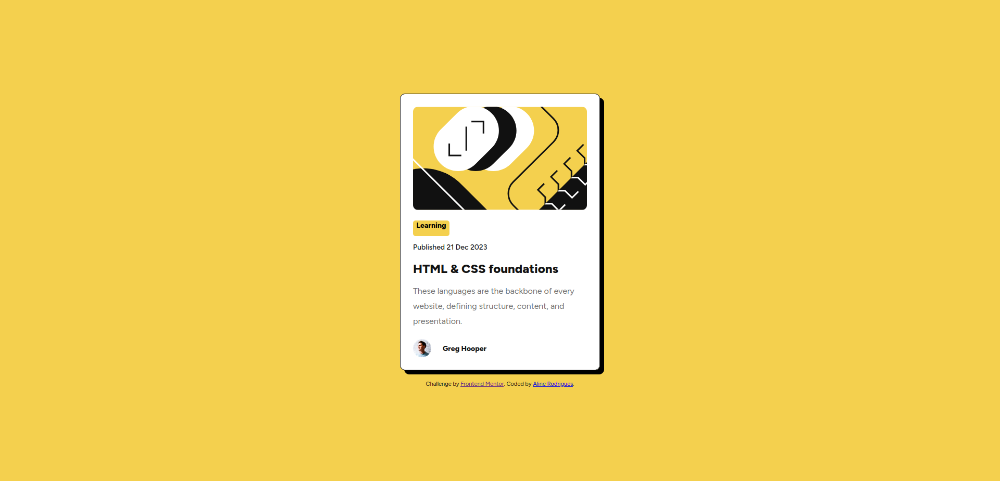

# Frontend Mentor - Solução para o Blog preview card

Esta é uma solução para o desafio [Blog preview card do Frontend Mentor](https://www.frontendmentor.io/challenges/blog-preview-card-ckPaj01IcS). Os desafios do Frontend Mentor ajudam você a melhorar suas habilidades de codificação construindo projetos realistas.

## Índice

- [Visão geral](#visão-geral)
  - [O desafio](#o-desafio)
  - [Screenshot](#screenshot)
  - [Links](#links)
  - [Feito com](#feito-com)
  - [O que eu aprendi](#o-que-eu-aprendi)
  - [Desenvolvimento contínuo](#desenvolvimento-contínuo)
- [Autor](#autor)

## Visão geral

### O desafio

Os usuários devem ser capazes de:
- Visualizar os estados de `hover` e `focus` para todos os elementos interativos na página (como o título do artigo).

### Screenshot

### Links

- URL da Solução: [GitHub](https://github.com/AlineRodrigues02/Preview-card.git)
- URL do Site ao Vivo (Live Site): [Site]( https://alinerodrigues02.github.io/Preview-card/)

### Feito com

- Marcação HTML5 semântica
- Propriedades customizadas CSS (Variáveis CSS)
- Flexbox para alinhamentos e layouts fluidos
- Abordagem de estilização limpa e estruturada (Mobile-first / Modular)
- Fonte personalizada [Figtree](https://fonts.google.com/specimen/Figtree)

### O que eu aprendi

Neste projeto, pratiquei a estruturação precisa de componentes de cartão (cards), aplicando sombras sólidas e bordas definidas alinhadas ao design system proposto.

## Autor

- Frontend Mentor - @AlineRodrigues02